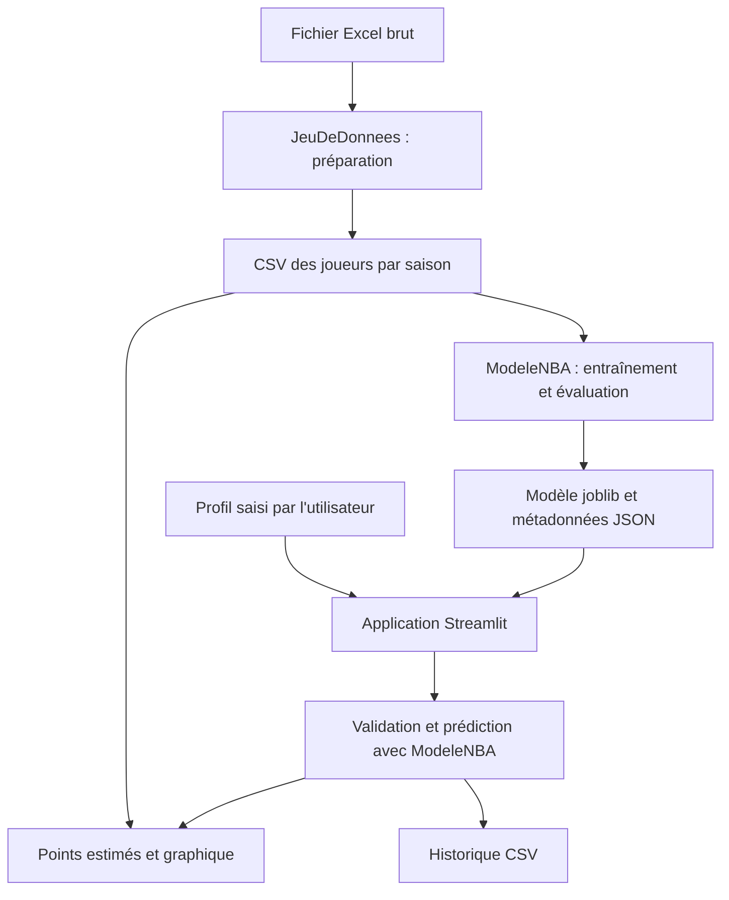
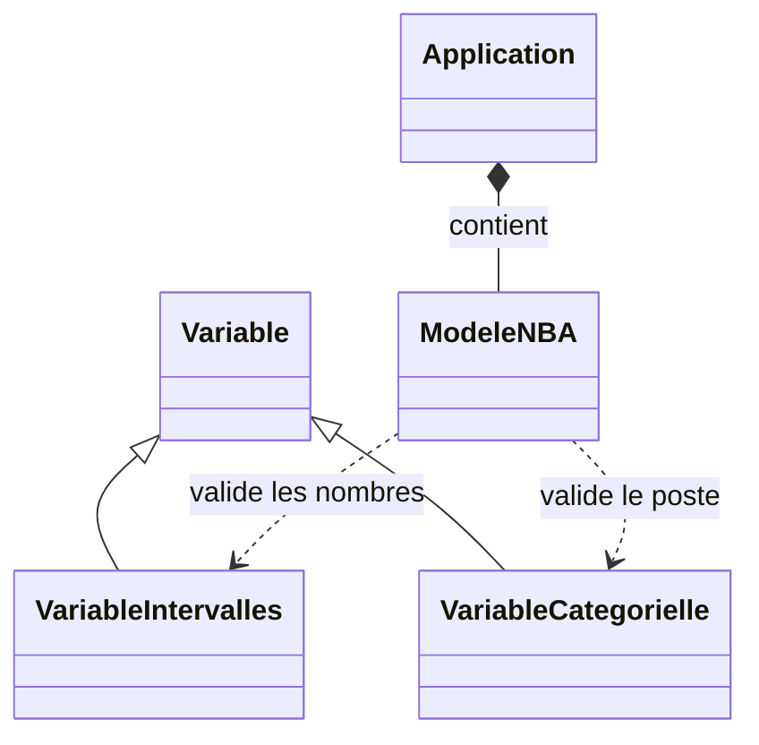

# Estimation des points NBA — Projet 2 INF1007

Notre application estime les points par match d'un joueur NBA à partir de son
profil statistique : poste, âge, minutes jouées, tirs tentés et autres statistiques.
Elle utilise une régression linéaire et une interface Streamlit qui fonctionne en
local. L'utilisateur saisit un profil, obtient une estimation et peut consulter
l'historique de ses prédictions.

Les données décrivent des joueurs sur une saison. L'application estime donc les
points moyens correspondant à un profil ; elle ne prédit pas le score exact du
prochain match.

## Installation et lancement

Python 3.10 ou plus récent est nécessaire pour les annotations de type utilisées.
Les tests et le calcul des résultats ci-dessous ont été vérifiés avec Python 3.13.3.

Le dépôt contient un sous-dossier qui porte lui aussi le nom `2026A-PR02`.
**Toutes les commandes ci-dessous se lancent dans le dossier contenant `src`,
`tests` et `requirements.txt`.** Depuis la racine Git du dépôt :

```bash
cd 2026A-PR02
```

Si vous utilisez déjà l'environnement Conda du cours, activez-le avec
`conda activate INF1007`. Utilisez ensuite le même terminal pour les commandes.

Installez les dépendances :

```bash
python -m pip install -r requirements.txt
```

Le fichier `requirements.txt` inclut les dépendances de l’application, pytest
et coverage.

Lancez l'interface :

```bash
python src/main.py
```

Le point d’entrée `main.py` lance Streamlit depuis le bon dossier avec le même
interpréteur Python. Il peut aussi être exécuté avec le bouton Python de l’éditeur.

Ouvrez l'adresse locale indiquée dans le terminal. Pour arrêter le serveur,
utilisez `Ctrl+C`. Il n'est pas nécessaire de réentraîner le modèle pour utiliser
l'application : le modèle sauvegardé et ses métadonnées sont déjà présents.

## Utilisation

1. Entrez un nom ou un pseudonyme pour reconnaître le profil dans l'historique.
2. Choisissez le poste et les valeurs numériques. Les bornes des champs viennent
   des métadonnées enregistrées avec le modèle.
3. Cliquez sur **Prédire**. Le résultat est exprimé en points par match.
4. Le graphique situe cette estimation dans la distribution des points du jeu de données.
5. Activez **Afficher l'historique** pour consulter les prédictions enregistrées.
   La suppression d'une ligne utilise un numéro qui commence à zéro.

Les profils et résultats sont conservés localement dans `historique_predictions.csv`.
Le nom saisi sert uniquement à identifier le profil dans ce fichier : ce n'est
pas une caractéristique utilisée par le modèle.

## Jeu de données et préparation

Le fichier utilisé par le modèle est
[`donnees/nba_joueur_saison_2005_2024.csv`](donnees/nba_joueur_saison_2005_2024.csv).
Il contient **8 289 observations et 12 colonnes**, dont 11 caractéristiques et
la cible `pts`. Il occupe environ 0,39 Mo, donc moins de 25 Mo.

- **Cible :** `pts`, les points moyens par match.
- **Variable catégorielle :** `pos`, le poste (`C`, `PF`, `PG`, `SF`, `SG`).
- **Variables numériques :** `season_year`, `age`, `games`, `minutes_per_game`,
  `2pa`, `3pa`, `trb`, `ast`, `stl` et `tov`.

Le fichier brut utilisé est `donnees/brut/1946 - Present - NBA Player Stats.xlsx`.
`JeuDeDonnees.preparer()` garde les lignes NBA à partir de 2005 avec au moins
20 matchs, sélectionne les colonnes utiles et renomme `Minutes Played` en
`minutes_per_game`. Le seuil de matchs limite les moyennes établies sur très peu
de rencontres. Le CSV actuel couvre 2005 à 2024 ; le filtre du code ne fixe pas
explicitement une année maximale.

Le CSV actuel ne contient aucune valeur manquante. Aucun remplacement automatique
des valeurs manquantes n'est programmé. Le script permet d'examiner les types,
les premières lignes, les postes et les valeurs absentes. Un histogramme des
points est enregistré dans `histogramme_pts.png`. L'analyse des valeurs aberrantes
reste à préciser avant la remise.

**Source :** [1946 - Present - NBA Player Stats (regular season)](https://www.kaggle.com/datasets/teteuvinicius/1946-present-nba-player-stats-regular-season),
publié sur Kaggle par le compte `teteuvinicius`. L’équipe a confirmé avoir utilisé
ce lien pour obtenir les données.

**Licence : à vérifier avant la remise.** La licence et les droits d’usage éducatif
et de redistribution ne sont pas encore confirmés. Vérifier la rubrique « License »
de la page Kaggle. Vérifier aussi le contenu du fichier brut avant sa remise : le
CSV final ne contient pas de colonne de nom de joueur.

## Modèle, évaluation et limites

Nous utilisons `LinearRegression` de scikit-learn : la cible est une valeur
numérique, et ce modèle fournit une solution simple à expliquer et rapide à
entraîner. Le poste est transformé en colonnes de 0 et de 1 avec `get_dummies`,
sans imposer un ordre entre les catégories.

La séparation utilise **80 % des observations pour l'entraînement** et **20 % pour
le test**, avec `random_state=42` : 6 631 lignes d'entraînement et 1 658 de test.
La métrique est la **MAE**, l'erreur absolue moyenne, exprimée en points par match.
La référence prédit toujours la moyenne des points de l'ensemble d'entraînement.

Résultats recalculés le 19 novembre 2026, sans remplacer les fichiers sauvegardés :

- **MAE de la régression linéaire : 0,7481 point par match.**
- **MAE de la référence : 4,8483 points par match.**
- Le calcul vectorisé NumPy donne le même résultat que scikit-learn, à la tolérance numérique près.

Sur cette séparation, le modèle fait mieux que la référence. La valeur de MAE
recalculée correspond aussi à celle du fichier `donnees/metadata.json`.
Cela ne signifie pas que chaque prédiction a une erreur inférieure à 0,75 point.

Quelques limites importantes :

- Les entrées, notamment les tirs tentés et les minutes, décrivent la même saison
  que les points. Le bon score ne démontre pas une capacité à prévoir une saison future.
- La séparation aléatoire peut placer différentes saisons d'un même joueur dans
  les deux ensembles. Une évaluation chronologique répondrait à une autre question.
- Les joueurs avec moins de 20 matchs sont exclus. Les résultats ne représentent
  donc pas tous les profils possibles.
- Une régression linéaire représente des relations simples. Elle peut produire
  une estimation négative pour certains profils ; le code refuse alors ce résultat.
- Aucun intervalle de confiance n'est calculé et aucune comparaison expérimentale
  avec un second modèle n'a été réalisée dans ce projet.

Pour réentraîner le modèle et remplacer sa sauvegarde et ses métadonnées :

```bash
python src/modele.py
```

Pour reconstruire le CSV depuis le fichier Excel et produire le graphique
d'exploration, en remplaçant les fichiers correspondants :

```bash
python src/donnees.py
```

## Organisation et schémas

```text
2026A-PR02/                  # racine Git
├── .github/workflows/tests.yml  # tests automatiques à chaque push
└── 2026A-PR02/              # dossier de travail des commandes ci-dessus
    ├── README.md
    ├── DECISIONS.md
    ├── JOURNAL_IA.md
    ├── requirements.txt
    ├── pytest.ini          # permet aux tests de trouver les modules dans src
    ├── donnees/             # fichier brut, CSV préparé et métadonnées JSON
    ├── modeles/             # modèle sauvegardé avec joblib
    ├── src/
    │   ├── donnees.py       # préparation et exploration
    │   ├── modele.py        # entraînement, évaluation et prédiction
    │   ├── variables.py     # validation des nombres et catégories
    │   ├── exceptions.py    # erreurs propres au projet
    │   ├── interface.py     # interface Streamlit et historique
    │   └── main.py          # lanceur de l’interface Streamlit
    ├── tests/
    │   ├── test_donnees.py
    │   └── test_modele.py
    ├── histogramme_pts.png
    └── historique_predictions.csv
```

Le parcours des données est le suivant. L'entraînement est séparé de l'utilisation
de l'application : le modèle est chargé, pas réentraîné à chaque prédiction.



Les principales relations entre les classes :



`JeuDeDonnees` prépare le fichier utilisé par `ModeleNBA`. La classe parente
`Variable` définit `valider`, redéfinie par `VariableIntervalles` et
`VariableCategorielle` pour leurs validations respectives. `Application` contient
une instance de `ModeleNBA`. L’attribut `_modele` est interne à `ModeleNBA` par
convention ; le préfixe `_` ne bloque pas techniquement l’accès extérieur.

**Outil du chapitre 7 :** le décorateur `@annoncer` affiche un message avant
l’exécution de la méthode d’entraînement.

## Tests et couverture

Depuis le même dossier de travail :

```bash
python -m pytest tests/ -v
```

Les **8 tests passent** lors de la vérification locale. Les cinq tests de
`test_donnees.py` vérifient les variables : poste valide ou invalide, âge usuel,
bornes et âge hors intervalle. Les trois tests de `test_modele.py` vérifient une
structure incorrecte, une variable manquante et la concordance du calcul de MAE.
Ils utilisent `pytest.raises` pour les erreurs et `pytest.approx` pour les flottants.

Ces tests ne couvrent pas encore tout le parcours d'une prédiction ni l'interface.
Leur réussite ne signifie donc pas que tout le programme est couvert.

**Couverture mesurée le 19 novembre 2026 : 19 % sur le dossier `src`, avec 8 tests réussis.**
Cette mesure inclut l’interface, même si les tests actuels portent sur la logique.
**Aucun pourcentage minimum n’est exigé par le mandat.**

Commandes pour installer coverage et refaire la mesure depuis le dossier contenant
`src` et `tests` :

```bash
python -m pip install coverage
python -m coverage run --source=src -m pytest tests/ -v
python -m coverage report -m
```

Le pourcentage se lit dans la colonne `Cover`, sur la ligne `TOTAL`.
La mesure réalisée par Codex a utilisé un environnement temporaire avec coverage,
les mêmes tests et le même périmètre `src`, sans modifier le code du projet.

## Intégration continue

Le workflow `.github/workflows/tests.yml`, placé à la racine Git, installe Python
3.13 et les dépendances, puis lance `python -m pytest tests/ -v` dans le
sous-dossier `2026A-PR02` à chaque push. Les exécutions des commits `07dadf0` et
`6be731b` ont réussi sur GitHub. Chaque nouveau push produit un nouveau résultat
à consulter dans l’onglet Actions.

## État des éléments à terminer

Le point d’entrée, les imports simples, la méthode parente de validation,
l’encapsulation de `_modele`, le décorateur, les dépendances, la mesure de
couverture et le workflow CI sont en place. Les exceptions personnalisées sont
interceptées dans le bloc de prédiction de l’interface.

Il reste notamment à :

- Confirmer la licence des données et compléter les validations de l’auxiliaire.
- Compléter les vérifications de fichiers, l'utilisation de `with` et la gestion
  des exceptions précises dans l'interface.
- Vérifier l’installation et le lancement depuis une copie neuve du dépôt.
- Compléter l’analyse des valeurs aberrantes, relire les docstrings et annotations
  des ajouts récents, et préparer la démonstration.

La fiche de [décisions](DECISIONS.md) explique les choix techniques.
Le [journal d'IA](JOURNAL_IA.md) décrit l'aide reçue, les vérifications et les
changements de décision. Pour la présentation, prévoir une démonstration d'un
profil valide, d'une saisie invalide et du graphique, ainsi qu'un plan B en captures
d'écran ou en vidéo.

## Documentation officielle

Pages consultées lors de la rédaction de cette documentation et à relire par l'équipe :

- [pandas — 10 minutes to pandas](https://pandas.pydata.org/docs/user_guide/10min.html) : tableaux, sélection et manipulation des données.
- [scikit-learn — LinearRegression](https://scikit-learn.org/stable/modules/generated/sklearn.linear_model.LinearRegression.html) : modèle utilisé pour estimer les points.
- [Streamlit — st.pyplot](https://docs.streamlit.io/develop/api-reference/charts/st.pyplot) : affichage d'une figure Matplotlib dans l'interface.
- [Coverage.py — exécuter une mesure](https://coverage.readthedocs.io/en/latest/commands/cmd_run.html) : mesure de la couverture lors de l'exécution des tests.
